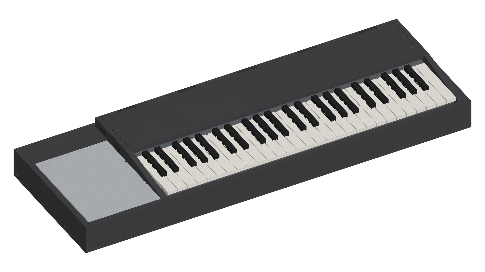
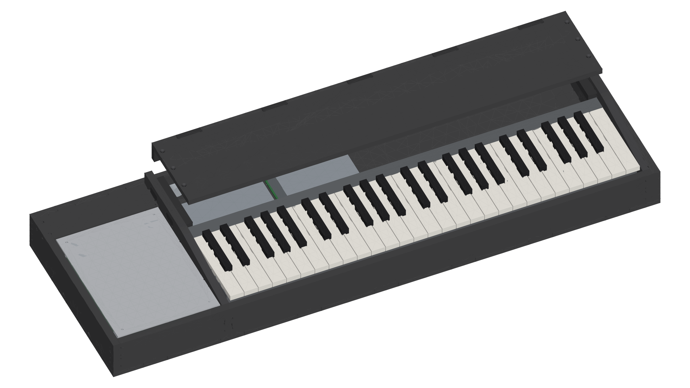
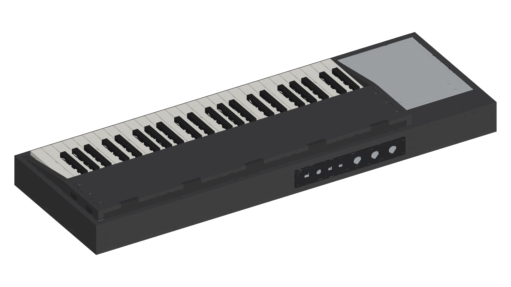
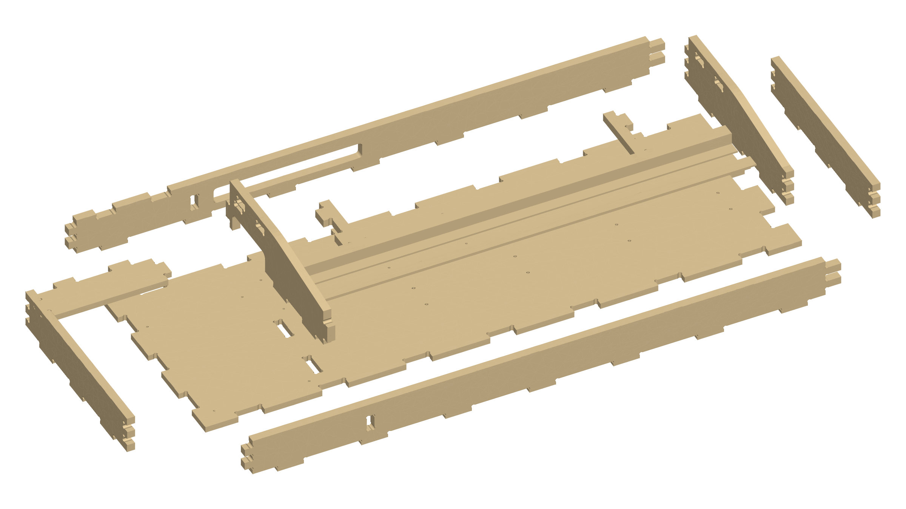
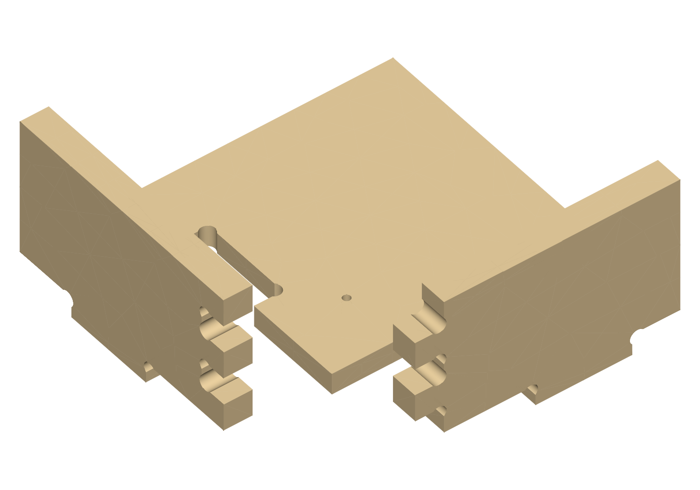

# ARP 3620 replica — wooden case

Wooden enclosure for a DIY replica of the **ARP 3620** duophonic keyboard (the
keyboard of the ARP 2600P), built around a current **Fatar TP/9S 49-key** keybed
instead of the original ARP key mechanism.

Birch plywood covered in black tolex, open on top (no lid since Rev0.4). All wooden parts
are cut on a CNC router and **plug together** — finger joints at the corners,
tabs into notches and through slots, glued; no screws in the carcass.
Everything is generated from one parameter file: 3D model with collision,
joint and assembly checks, a DXF per part plus one per sheet thickness, renders
and a 10-sheet production drawing.

**Status: Rev0.5, design stage — not built yet.** Read the open points below
before cutting.



| | |
|---|---|
|  |  |
| Strip lifted: electronics bay | Rear: connector plate |
|  |  |
| Plugged together (exploded) | Front left corner: fingers, tabs, dogbones |

## Concept

- **Layout as on the original and the 2014 clone:** control panel on the left,
  flush with the walls, keybed on the right between two cheeks, a raised strip
  behind the keys.
- **Heights follow from the keybed.** The keybed is screwed onto two aluminium
  Z profiles 20 × 20 × 2 (as on the MS2600 clone): from above through the keybed
  holes into rivet nuts in the top flanges, with the keys over the holes taken
  off. The unit is then screwed to the base from below into rivet nuts in the
  bottom flanges, which point inwards under the keybed. The lower edge of the
  white key fronts (39.3 above the mounting plane, Fatar drawing 1:1, checked on
  the keybed) sits just above the wall top. This leaves 56 mm under the control
  panel for the 3620 board.
- **Electronics bay behind the keybed**, under the removable strip: bus emulator
  Rev0.3 (160 × 86) and power supply board (126 × 80). The Pico's USB goes to
  the rear plate through a panel-mount cable (Adafruit 3258); its plug lies
  over the board, the cable bends down behind it (34 mm free to the rear wall). Cables to the panel section run
  through a notch in the left cheek.
- **Rear connector plate** (aluminium 2 mm) over a window in the rear wall: USB
  (panel-mount cable), DC IN, POWER, SUPPLY 2600/INT, MIDI IN, MIDI OUT, MIDI THRU. The connection to
  the ARP 2600 (6-pin GX16) sits on the control panel.
- **No lid** (since Rev0.4): the case ends with the walls at 67 and the strip
  at 90.

## Joints (CNC, plug together)

| Where | Joint |
|---|---|
| Wall corners | finger joint, 5 fingers over 50 mm (bottom, middle and top finger on the end wall) |
| Walls → base | tabs 40 mm wide, 9 deep into notches in the base edge, flush underneath |
| Left cheek | tabs through slots in the base and the front/rear wall |
| Right cheek | stands against the right end wall and shares its fingers and tabs (24 mm deep joints) |
| Filler behind the panel | tabs into the left end wall and the rear wall (notches from the top) and through the left cheek |
| Strip cleats | lying flat, tabs through the cheeks |
| Apron → strip | tabs into notches at the rear edge of the strip |

- **Dogbones R 3.2** in every inside corner, so end mills up to 6.35 mm cut
  them and square tabs still seat. On the outside they sit under the tolex;
  fill them before covering.
- **Play 0.15 mm** per joint: notches and slots are that much wider than the
  tab (`FIT`). Joint depth equals the sheet thickness — **measure the plywood
  and enter the real thickness** (`T_*` in `params.py`) before cutting.
- Glue all joints. The strip stays removable on screws, the keybed unit is
  screwed from below through the base.
- **Assembly order** (checked in the model, each part slides into place without
  touching the parts already there): base, Z profiles, cheeks down, cleats through
  the cheeks, filler into the left cheek, front wall, rear wall, end walls from
  the sides. Drawing sheet 9.

| | |
|---|---|
| Outside | 911 × 310 mm, walls 67 high, strip 90 (+ feet 12), no lid |
| Material | birch plywood 12 / 9 mm, black tolex, aluminium rear plate |
| Mass | approx. 4.3 kg wood and plate, without keybed and electronics |
| Keybed | Fatar TP/9S 49 (683 × 161.5) on two aluminium Z profiles 20 × 20 × 2, 670 long |
| Control panel | 170 × 230, PCB 1.6, on four M3 standoffs 56.4 mm from the base |

## Differences to the original 3620

- **Keys set back behind a front wall.** On the original the white keys reach
  almost to the front edge of the case (a top-view photo in the owner's manual
  shows only a 2–3 mm rim). Here the key fronts sit 15 mm behind the outer face
  (12 mm front wall + 3 mm clearance); the white key tops stand 9.5 mm above the
  wall. Kept on purpose (decision 09.10.2026).
- **Deeper case** (310 mm instead of roughly the panel depth of the original) for
  the electronics bay behind the keybed.

## Files

| Path | Content |
|---|---|
| [`production/ARP3620_Woodcase_Rev0.5_drawing.pdf`](production/ARP3620_Woodcase_Rev0.5_drawing.pdf) | Drawing, A3, 10 sheets: overview, general arrangement, sections, every part with dimensions and hole tables, joints and assembly order, cut list, hardware |
| [`production/ARP3620_Woodcase_Rev0.5_drawing_de.pdf`](production/ARP3620_Woodcase_Rev0.5_drawing_de.pdf) | The same drawing in German (Zeichnung auf Deutsch); texts in `scripts/lang_de.py` |
| [`production/carpenter/`](production/carpenter/) | Drawing for a carpenter without CNC (German, A3, 8 sheets): the same case with butt joints (walls on the base, front and rear wall full length, filler on two cleats), cut list, views, sections and part sketches with straight edges only, no holes. Made by `scripts/carpenter.py`, checked against `params.py` and the STEP (`check_carpenter.txt`) |
| `scripts/fit3d/`, `model/fit3d/fit_report.txt` | 3D fit check of the whole instrument: the case as the carpenter builds it, Z profiles, keybed (keys at rest and pressed) and the four ARP 3620 boards from KiCad (STEP with the KiCad 3D models, envelopes from the datasheet for parts without a model). Collisions and clearances in `fit_report.txt`, viewer page in `scripts/fit3d/viewer/` (three.js). Rebuild with `scripts/fit3d/make_fit3d.sh` |
| [`production/dxf/`](production/dxf/) | One DXF (R12, mm) per distinct part, seen from its front face, origin at its lower left corner. Layers `OUTLINE`, `CUTOUT`, `DRILL`, `CSK_FRONT`, `CSK_BACK` (countersink on the far face), `PILOT`, `ENGRAVE`, `NOTE` |
| [`production/dxf/sheets/`](production/dxf/sheets/) | One DXF per plywood thickness (12 / 9 mm) with every part in its quantity on a 2500 × 1250 sheet, laid out in rows — for the CNC shop to nest |
| [`production/ARP3620_Woodcase_Rev0.5.step`](production/ARP3620_Woodcase_Rev0.5.step) | All case parts as solids |
| `model/` | FreeCAD file, assembly STEP with simplified reference bodies (keybed, panel, boards), check report, DXF preview |
| `images/` | Renders |
| `scripts/` | Generator, see below |

## How the data are made

Nothing is drawn by hand. `scripts/params.py` holds every dimension,
`scripts/parts.py` describes each part as a flat outline with holes and
cut-outs. From that:

```bash
scripts/make.sh
```

runs `build.py` (FreeCAD: solids, collision and clearance checks, STEP),
`dxf_out.py` and `dxf_preview.py` (DXF, read back with an independent parser),
`render.py` and `drawing.py`. Needs FreeCAD 1.x (`freecadcmd`) and Python 3 with
matplotlib.

**Checked in the 3D model** (`model/check.txt`): every part is a valid solid,
95 part pairs without collision, all 29 joints in contact, no void in the outer
shell larger than a dogbone (a notch without its tab would show), every part
slides into place in the assembly order, and the clearances keybed–cheeks 3,
keys–front wall 3, panel all round 2, and electronics to strip,
apron and rear plate parts.

## Open points (check before cutting)

- **Sheet thickness.** Measure the plywood and enter it in `params.py`
  (`T_WALL`, `T_BASE` …), then run `scripts/make.sh`: slots and joint depths
  follow from it.
- **Keybed screws.** The feet have 4.5 mm holes; M4 screws from above into
  rivet nuts in the Z profiles. Check that the heads clear the keys put back on.
- **Space under the control panel.** The 12 mm board spacer and 25 mm for parts
  and plugs under the 3620 board are estimates. Check them with the built board.
- **Rear plate.** The hole sizes are placeholders until the sockets and
  switches are chosen.
- **Bus emulator Rev0.3** is not on the main branch of the board project yet
  (Patrick reviews it). Its standoff holes in the base follow it; check again
  if it changes.
- **USB cut-out** in the rear plate (10 × 6 between the two M3 screws of the
  Adafruit 3258 socket, 17.3 apart) is a placeholder: check it on the part.
- **Hardware.** Optional handle and case corners.

## Revisions

- **Rev0.5** — bus emulator Rev0.3 (160 × 86 instead of 160 × 110, six M3
  holes, other positions); rear plate 251 long with a third DIN socket MIDI
  THRU, window in the rear wall 227 long; USB as panel-mount cable Adafruit
  3258 (two M3, cut-out) instead of the dia 24 placeholder. Carpenter drawing
  Rev0.5-T1.
- **Rev0.4** — no lid: lid top, lid walls and draw latches dropped (Patrick,
  11.11.2026); 6 mm plywood no longer needed. Case height 90 at the strip.
  Carpenter drawing Rev0.4-T1.
- **Rev0.3** — keybed on two aluminium Z profiles 20 × 20 × 2 instead of
  12 mm plywood risers (as on the MS2600 clone); everything 8 mm higher.
  KB_LIP 39 confirmed (Fatar drawing 1:1: 39.3). Carpenter drawing Rev0.3-T1.
- **Rev0.2** — CNC plug-together: finger joints, tabs, slots, dogbones; no
  screws in the carcass, filler cleats dropped, strip cleats plug through the
  cheeks. Control panel as PCB 1.6 (standoffs 48.4 mm). Sheet DXFs per
  thickness.
- **Rev0.1** — first design: butt joints, glued and screwed.

## Reference: the 2014 clone

The DIY clone from 2014 (Muffwiggler group buy) used a black MDF case,
915 × 257 mm, with a lid. Its drawings were made for a Kimber Allen keybed and
are **not part of this repository** — they are third-party work and stay with
their author. They are attached to the project page in the wiki:
[ARP 3620 Keyboard Clone](https://diysynth.wiki.dsl-man.de/wiki/spaces/DSO/pages/1146915).
This design takes only the overall concept from them; all dimensions are derived
anew from the Fatar keybed and the panel.

## License

© 2026 Dsl-man.de

Licensed under [Creative Commons Attribution-ShareAlike 4.0 International](LICENSE)
(CC BY-SA 4.0), including the generator scripts. You may build, modify and
redistribute this design, commercially too, as long as you credit the source and
share your changes under the same license.

Not covered by this license: third-party documents referred to above (the 2014
case drawings, the Fatar datasheet), which keep their own rights. The keybed
dimensions used here are taken from the Fatar TP/9S datasheet.

ARP and ARP 3620 are names of ARP Instruments, Inc. This is an independent
DIY project, not affiliated with or endorsed by ARP or its successors.
